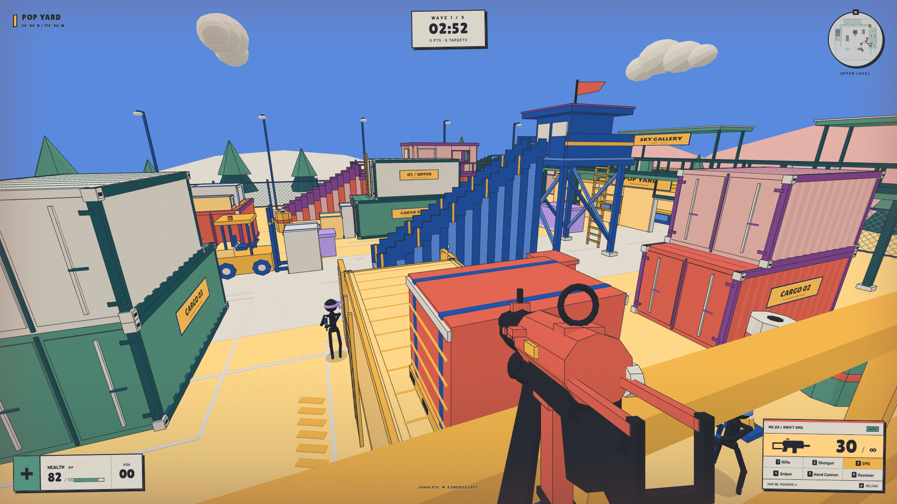
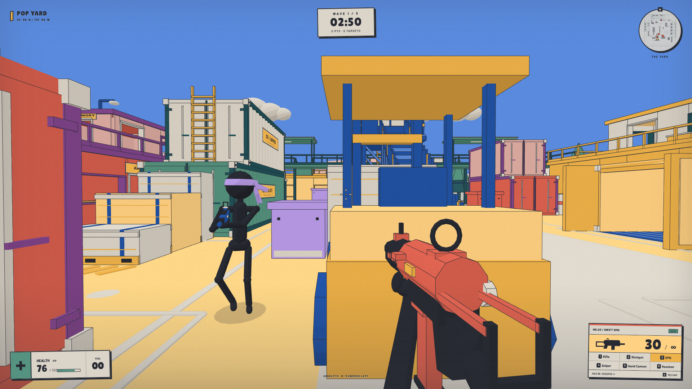
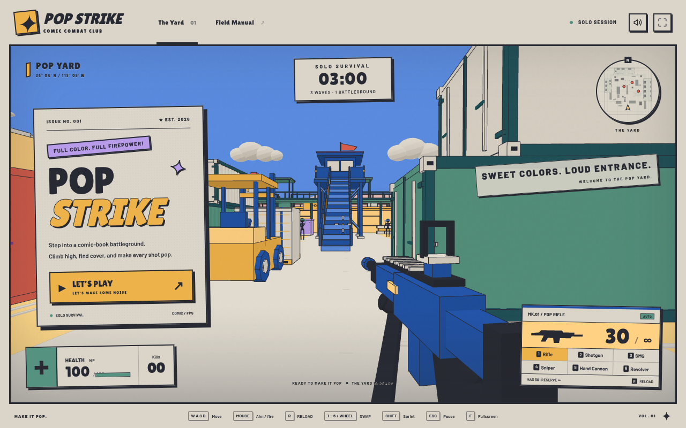
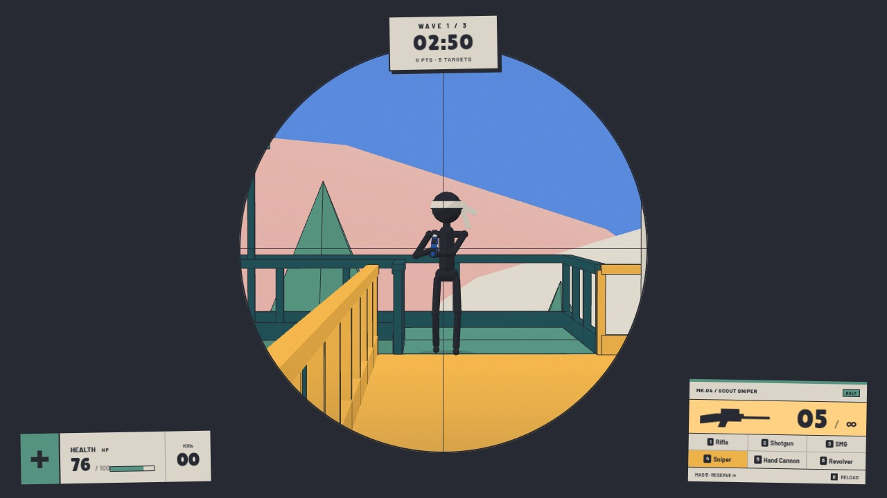
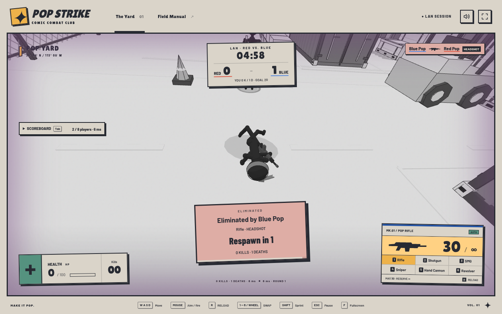

# Pop Strike

**Make it pop.**

A colorful 3D comic-book shooter built with Three.js. Climb stacked cargo, cross upper walkways, and survive three enemy waves before time runs out. Play solo in your browser or host a red-versus-blue LAN battle for 2–8 players.

English · [简体中文](README.zh-CN.md)



## Features

- **Solo Survival:** clear three waves in three minutes. Land headshots, chain eliminations, recover health, and beat your locally saved high score.
- **LAN Battle:** automatically balanced red and blue teams, five-minute rounds, and a race to 20 team kills. No friendly fire; respawn after three seconds.
- **Six distinct weapons:** individual colors, gun models, recoil, firing sounds, and reload animations, including a scoped bolt-action sniper rifle.
- **A vertical battleground:** enter buildings, climb stairs and ladders, mantle crates, and fight across balconies, rooftops, and covered catwalks.
- **Comic-book presentation:** bold outlines, the Nostalgos-12 palette, animated headband tails, varied death poses, and a grayscale death camera.
- **Clear team feedback:** colored headbands, a teammate-only LAN radar, a killfeed, team scores, and a respawn countdown.
- **Local assets:** Three.js, fonts, and game assets are bundled. Sound effects are synthesized with Web Audio; no CDN access or npm dependency installation is needed to play.

## Screenshots

These are captures from the English edition.

| Ground combat | Main menu |
| --- | --- |
|  |  |
| **Sniper scope** | **LAN death and respawn** |
|  |  |

## Quick start

Use a desktop browser with WebGL 2 support. The host needs **Node.js 22 or newer**; building the English edition also needs **Python 3**. Keyboard and mouse are recommended. Touch controls are included, but mobile browsers have not been fully validated.

### English edition

From the repository root:

```bash
python3 scripts/build_release.py
node dist/pop-strike-lan-en/pop-strike/server.mjs
```

On Windows, use `py -3` in place of `python3` if needed.

Open **http://localhost:5173/index.html**. Choose **LET'S PLAY** for solo survival or **LAN Battle** to join a room. Keep the terminal open while playing; press `Ctrl+C` to stop the host.

For a solo-only preview without Node.js, build the English edition and run:

```bash
python3 -m http.server 8000 --bind 127.0.0.1 --directory dist/pop-strike-itch-en
```

Then open **http://localhost:8000/index.html**. This static server does not provide LAN multiplayer. Serve the game over HTTP rather than opening `index.html` as a local file.

### Original Chinese edition

The editable source in `pop-strike/` retains its Chinese interface:

```bash
node pop-strike/server.mjs
```

`npm run dev` starts the same server. On macOS or Linux, `bash start-lan.sh` is another entry point. No `npm install` is required.

## Play over LAN

1. Start the English or Chinese Node host on one computer.
2. Open the host's printed LAN address on each player's browser, such as `http://192.168.1.23:5173`. All players must be on the same local network.
3. Select **LAN Battle**, enter a callsign, and join. Teams are assigned automatically; a round starts when two players have joined.
4. The first team to 20 kills wins. After five minutes, the team with more kills wins; equal scores are a draw. The next round starts after a ten-second break.

Guests only need a browser. The host handles movement, collision, hits, ammunition, scoring, and respawns. Pressing `Esc` releases your cursor but does not pause a LAN match.

If another computer cannot connect, use the host's LAN address instead of `localhost`, allow the host port through its firewall on your local network, and check whether the Wi-Fi isolates clients. The default port is `5173`; set `PORT` to change it. For example, on macOS or Linux:

```bash
env PORT=5174 node dist/pop-strike-lan-en/pop-strike/server.mjs
```

LAN Battle uses a local host; there is no public matchmaking service.

## Controls

| Action | Controls |
| --- | --- |
| Move | W A S D |
| Look | Mouse |
| Fire | Left click; hold for automatic weapons |
| Aim / sniper scope | Hold right click |
| Reload | R |
| Switch weapon | 1–6 / mouse wheel |
| Sprint | Left Shift |
| Jump / mantle | Space / hold Space while moving toward a reachable ledge |
| Grab or release ladder | E |
| Climb / jump off ladder | W and S / Space |
| LAN scoreboard | Hold Tab |
| Pause / release cursor | Esc |
| Fullscreen | F |
| Toggle sound | M |

Walk directly through open doorways and up stairs. Fullscreen hides the outer navigation and control guide while keeping the game HUD. If pointer lock is unavailable, drag with the left mouse button to look around.

## Arsenal

| Key | Weapon | Color | Magazine | Fire mode |
| --- | --- | --- | --- | --- |
| 1 | Pop Rifle | Blue | 30 | Automatic |
| 2 | Pump Shotgun | Gold | 6 | Pump-action; 9 pellets per shot |
| 3 | Swift SMG | Coral | 30 | Automatic |
| 4 | Scout Sniper | Green | 5 | Bolt-action with scope |
| 5 | Hand Cannon | Lavender | 7 | Semi-automatic |
| 6 | Sixshot Revolver | Ivory | 6 | Single shot per click |

Each weapon keeps its own magazine. Reserve ammunition is unlimited; firing with an empty magazine starts a reload. Switching weapons cancels an unfinished reload and preserves the current ammunition count. Weapon switching does not bypass firing cooldowns.

## Build and distribute

```bash
python3 scripts/build_release.py
# Equivalent npm shortcut:
npm run build:release
```

| Generated file | Contents |
| --- | --- |
| `dist/pop-strike-itch-en.zip` | English solo browser edition, with `index.html` at the ZIP root |
| `dist/pop-strike-lan-en.zip` | English solo and LAN edition, Node host, instructions, and launch scripts |

The solo build can run on a static host. LAN play requires the Node/WebSocket host. The [itch.io publishing guide](docs/itch-io.md) includes upload instructions and an English store description.

English translations live in [`scripts/release/en.json`](scripts/release/en.json), with layout adjustments in [`scripts/release/en.css`](scripts/release/en.css). Edit source files, then rebuild; `dist/` contains generated output and is excluded from version control. README screenshots are kept separately in `docs/images/`.

When sharing the source repository, include `pop-strike/`, `docs/`, `scripts/`, both README files, the root `package.json`, `start-lan.sh`, and `.gitignore`. Keep `dist/` out of the source upload; it contains generated releases, local recordings, and archived development screenshots.

## Development

```bash
npm run check
npm test
```

The tests cover player movement, collisions, buildings, upper routes, cargo cover, character animation, weapon behavior, death cameras, team rules, authoritative combat, and WebSocket handling.

| Path | Purpose |
| --- | --- |
| `pop-strike/game.js` | Main loop, solo combat, input, and HUD |
| `pop-strike/world.js`, `upper-yard.js`, `cargo-yard.js` | Procedural arena and its vertical routes |
| `pop-strike/physics.js`, `navigation.js` | Player movement and enemy navigation |
| `pop-strike/enemy.js`, `death-view.js` | Characters, animation, and death camera |
| `pop-strike/weapons.js`, `weapon-models.js`, `audio.js` | Arsenal, weapon models, and procedural sound |
| `pop-strike/server.mjs`, `room.mjs`, `websocket.mjs` | HTTP host, authoritative matches, and transport |
| `pop-strike/multiplayer.js` | LAN client and remote players |
| `pop-strike/palette.js`, `style.css` | World colors and interface styling |
| `scripts/build_release.py` | English edition and ZIP packaging |
| `pop-strike/tests/` | Automated regression tests |

Refresh browser clients after changing game files. Restart the host as well after changing maps, physics, weapons, or server logic so both sides use the same rules.

## Credits

- **Three.js:** bundled locally; see its [MIT license](pop-strike/vendor/THREE-LICENSE.txt).
- **Fonts:** Lilita One, ZCOOL KuaiLe, Barlow, and Barlow Condensed. Their SIL Open Font License notices are included for [Lilita One](pop-strike/fonts/LilitaOne-OFL.txt), [ZCOOL KuaiLe](pop-strike/fonts/ZCOOLKuaiLe-OFL.txt), and [Barlow](pop-strike/fonts/OFL.txt).
- **Palette:** Nostalgos-12, with shared color definitions in [`pop-strike/palette.js`](pop-strike/palette.js).
